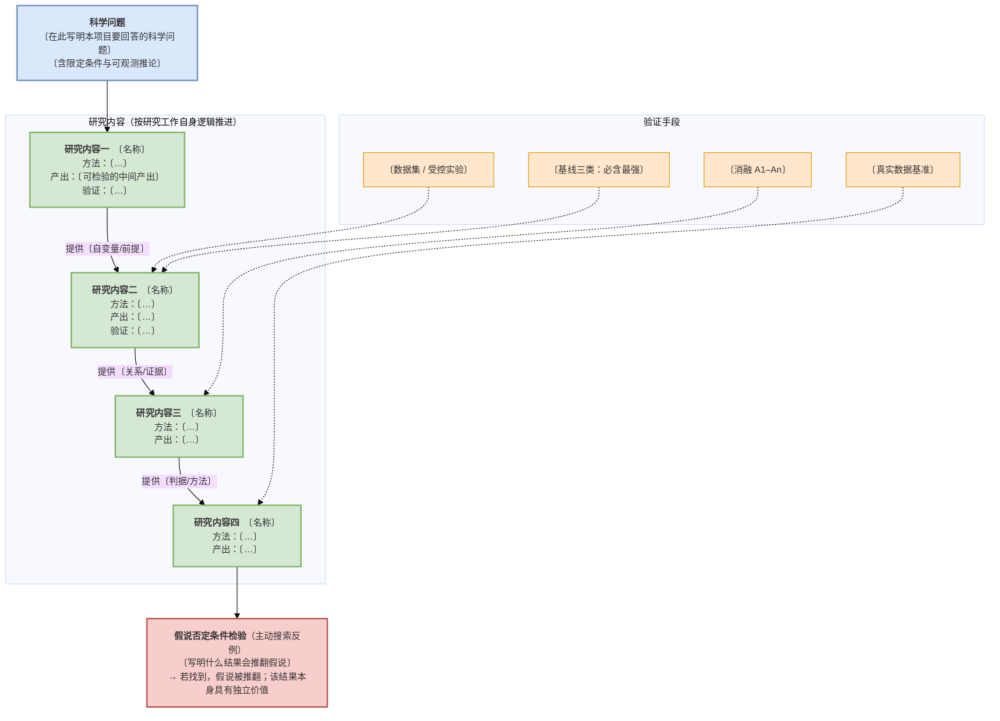
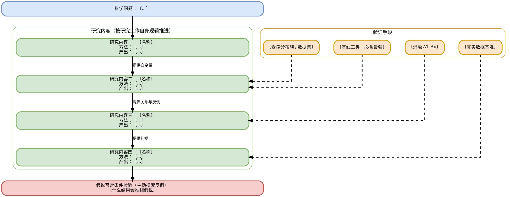

# 技术路线图模板（三格式）

> 本文件提供技术路线图的三种可编辑格式模板。把方括号内容替换为你的项目信息即可。
> 对应正文位置：**（二）研究内容 → 3.5.2 技术路线图**
>
> *OpenNFSC · powered by gary*

---

## 图形必备要素（评审可读性要求）

1. **顶部写明科学问题** —— 评审第一眼看到研究要回答什么
2. **研究内容作为模块** —— 3-4 项，顺序即研究推进顺序
3. **模块间箭头标注输入输出关系** —— 不能只有并列方块
4. **每模块标注可检验产出与验证方式**
5. **右侧或下方独立列出验证手段**（数据集 / 基准 / 基线 / 消融）
6. **底部可单列假说否定条件检验** —— 体现可证伪设计

---

## 格式一：Mermaid（最快，可在线预览）

粘贴到 https://mermaid.live 即可预览并导出 PNG/SVG。



---

## 格式二：Graphviz DOT（自动化排版）

安装 Graphviz 后：`dot -Tpng 技术路线图.dot -o 图1-技术路线图.png`



---

## 格式三：draw.io（**推荐**，可直接拖拽调整）

`bin/md2tex.mjs` 与 `bin/cli.mjs` 都不直接生成 drawio；请用以下步骤：

1. 打开 https://app.diagrams.net （无需注册）
2. **Create New Diagram** → 空白图
3. 按 Mermaid 版本的结构手工摆放 6 类方框（科学问题 / 4 个研究内容 / 验证手段 / 否定条件）
4. 配色建议（与上面两种格式一致）：
   - 科学问题：填充 `#DAE8FC`，边框 `#6C8EBF`
   - 研究内容：填充 `#D5E8D4`，边框 `#82B366`
   - 验证手段：填充 `#FFE6CC`，边框 `#D79B00`
   - 否定条件：填充 `#F8CECC`，边框 `#B85450`
5. 导出：**File → Export as → PNG**，宽度设为 1600 px 以上
6. 命名为 `图1-技术路线图.png`，放到 `deliverables/` 下与 `.tex` 同目录
7. 重跑出稿脚本，图片会自动插入

---

## 插入正文的方式

在 `deliverables/申请书正文.md` 的（二）3.5.2 处写：

```markdown
##### 3.5.2　技术路线图


**图1　项目技术路线图**

图形说明：〔一段话说明图的层次与各模块关系〕
```

`bin/md2tex.mjs` 会把它转成：

```latex
\IfFileExists{图1-技术路线图.png}{\begin{center}\includegraphics[width=\linewidth]{图1-技术路线图.png}\end{center}}{...占位框...}
```

**PNG 不存在时自动回退为占位框，不会导致编译失败。**

---

## 排版建议

| 项 | 建议 |
|---|---|
| 图幅 | A4 横向或半页 A4（约 1100 × 860 px 起） |
| 字号 | 框内正文缩放后不小于 9 pt |
| 颜色 | 用四色区分层次（蓝=问题 / 绿=研究内容 / 橙=验证 / 红=否定条件） |
| 位置 | 置于（二）3.5.2，或按申报习惯置于（二）开头 |
| 一致性 | 图中模块名须与正文标题**逐字对应**；正文改动后同步更新图 |
